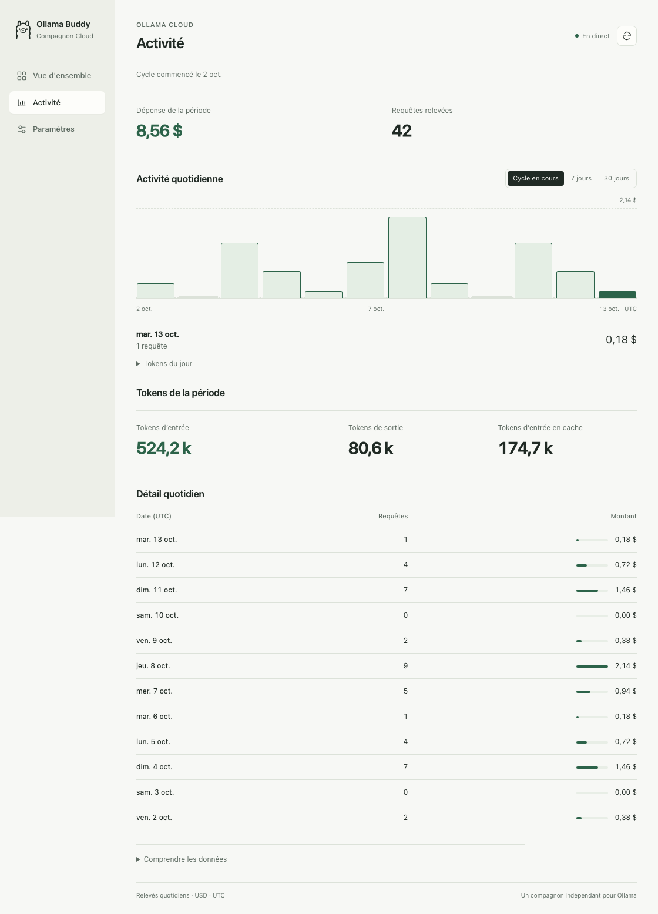
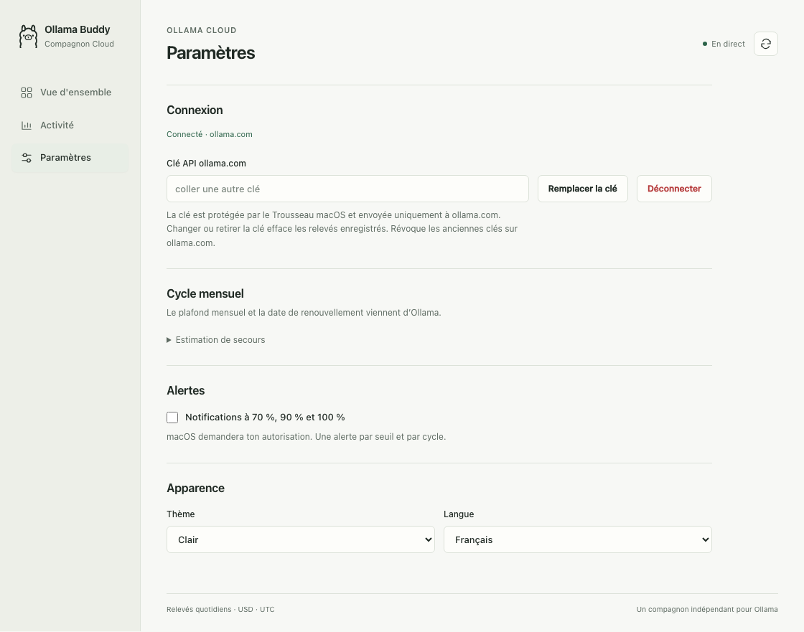
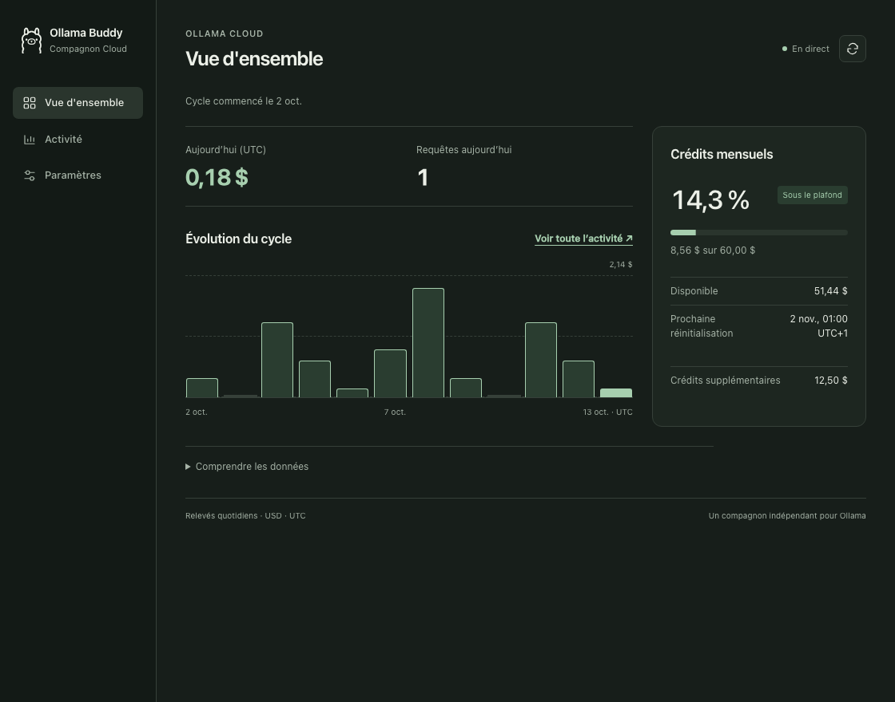
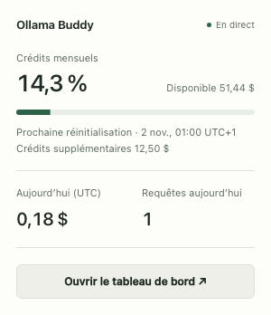

<div align="center">
  
  <h1>Ollama Buddy</h1>
  <p><em>Ta consommation Ollama Cloud sur ton Mac — crédits officiels, tokens, mises à jour en direct</em></p>

  [English](README.md) · [Interface](#interface) · [Installation](#installation) · [Cycle mensuel](#cycle-mensuel) · [Sécurité](#sécurité)
</div>

Ollama Buddy lit les dépenses quotidiennes de ton compte Cloud avec ta propre clé
API. Un serveur Python fournit un tableau de bord dans une fenêtre macOS native,
avec un résumé dans la barre de menus. Le serveur peut aussi fonctionner seul,
dans un navigateur.

- Vue d’ensemble : dépense et requêtes du jour, crédits mensuels et aperçu du cycle.
- Vue **Activité** avec graphique interactif sur le cycle en cours ou 7/30 jours calendaires et
  tableau de tous les relevés de la période disponible. Les jours manquants
  sont distingués des jours à dépense nulle.
- Paramètres dédiés : connexion, cycle mensuel, alertes et apparence. Les saisies
  en cours sont conservées pendant les mises à jour en direct.
- Plafond, crédits mensuels restants, date de réinitialisation et crédits supplémentaires officiels.
- Tokens d’entrée, de sortie et en cache sur le cycle ou les 7/30 jours sélectionnés dans Activité.
- Projections estimatives après une journée complète de mesures du solde.
- Notifications natives optionnelles à 70 %, 90 % et 100 % du quota mensuel consommé.
- Français/anglais et thèmes automatique/clair/sombre dans les paramètres.
- Clé de l’app native dans le Trousseau macOS, avec migration de l’ancien fichier.
- Bibliothèque standard Python 3.9+ à l’exécution, sans framework frontend.

## Interface

Captures de la refonte sur des données fictives, en français. Elles sont générées
avec le même serveur et les mêmes pages que l’app.

**Vue d’ensemble** : usage du jour et crédits mensuels. Une barre de l’aperçu
ouvre son jour dans Activité, qui regroupe l’analyse, les tokens et le tableau.


<details>
<summary>Voir l’activité, les paramètres, le thème sombre et la barre de menus</summary>

### Activité

L’activité démarre au dernier renouvellement. Passe entre le cycle en cours
et 7/30 jours de ce cycle, avec les compteurs de tokens. Un jour manquant se distingue d’un jour à dépense nulle.



### Paramètres

Configure la connexion, les alertes et l’apparence. Le cycle vient d’Ollama ;
les réglages de secours facultatifs utilisent une référence UTC avec son équivalent local.



### Thème sombre



### Barre de menus

Consulte les crédits restants, le renouvellement local et l’usage du jour, puis
ouvre le tableau de bord. Les crédits supplémentaires à zéro sont masqués.



</details>

## Installation

Pour construire l’app : macOS 12+, outils en ligne de commande Xcode (`swiftc`,
`lipo`, `iconutil`, `codesign`), Python 3.9+ et Pillow pour l’icône.

```bash
xcode-select --install
pip3 install pillow

git clone https://github.com/fwBoa/ollama-buddy.git
cd ollama-buddy
./build_app.sh
open "Ollama Buddy.app"
```

Le bundle contient les exécutables Apple Silicon et Intel. Ajoute `--install`
pour le copier dans `/Applications`. Le lanceur natif utilise `/usr/bin/python3` :
les outils Xcode sont donc aussi nécessaires à l’exécution.

L’app porte une signature ad-hoc, sans notarisation Developer ID. Gatekeeper peut
bloquer un bundle téléchargé ; la construction locale est l’installation recommandée.
Uniquement pour un bundle de confiance, la quarantaine peut être retirée avec :

```bash
xattr -dr com.apple.quarantine "/Applications/Ollama Buddy.app"
```

Pour utiliser le tableau de bord sans l’enveloppe native :

```bash
python3 ollama_buddy.py
# Options : --no-browser --port 11499
```

Fermer la fenêtre laisse l’app dans la barre de menus. `⌘Q` arrête le serveur si
c’est cette app qui l’a démarré ; un serveur natif compatible préexistant reste
actif. Au lancement, l’app vérifie que le serveur réutilisé prend en charge le
suivi quotidien depuis le renouvellement, Balance et les tokens. Le serveur CLI est séparé pour que l’app native utilise le Trousseau.

## Connexion et réglages

1. Crée une clé sur [ollama.com/settings/keys](https://ollama.com/settings/keys).
2. Colle-la dans le tableau de bord.
3. L’app lit le plafond, les crédits restants et les dates exactes du cycle via
   [Balance Ollama](https://docs.ollama.com/api/balance), avec la même clé.
4. **Paramètres** conserve un plafond et une référence UTC facultatifs pour
   l’estimation de secours. Ils s’appliquent uniquement si Balance est indisponible.
   Sans plafond manuel, le secours utilise les valeurs du plan local (Pro 60 $,
   Max 300 $, Team 1 000 $), qui ne font pas autorité pour ton contrat réel.

Le bouton en haut à droite actualise les données. Les listes de thème et de
langue vivent dans les paramètres et suivent le système par défaut.
Les deux préférences sont enregistrées sur le serveur.

La date de réinitialisation apparaît une fois en heure locale, avec le fuseau ;
la référence UTC est disponible dans une infobulle. Les crédits supplémentaires sont séparés des crédits mensuels inclus.
Déconnecter exige une confirmation et efface l’historique local du compte.

| Raccourci | Action |
|---|---|
| `⌘1` | Afficher la fenêtre |
| `⌘R` | Recharger le tableau de bord |
| `⌘⇧R` | Vider le cache et actualiser |
| `⌘O` | Ouvrir dans le navigateur |
| `⌘Q` | Quitter |

La barre de menus affiche un lama et le pourcentage consommé : alerte orange à 70 %,
rouge à 90 %. Une mesure indisponible affiche un tiret. Le résumé montre les
dépenses et requêtes du jour. Les anciens compteurs par modèle ne sont plus affichés.

## Cycle mensuel

Le quota vient de [`GET /api/balance`](https://docs.ollama.com/api/balance) :
`included.allowance_usd`, `included.balance_usd`, les bornes exactes `from`/`until`
et `purchased.balance_usd`. Les crédits mensuels consommés correspondent au
plafond moins le solde restant. Les crédits supplémentaires sont séparés et
n’entrent pas dans ce pourcentage. Le solde officiel fonctionne sans date saisie
ni historique quotidien complet, y compris le jour de la réinitialisation.

Les anciennes offres renvoient des limites par session et par semaine. L’app
montre leurs pourcentages restants, sans inventer de quota mensuel en dollars ni
envoyer d’alertes mensuelles. Un plafond inclus nul n’affiche pas de pourcentage
artificiel. Pour une équipe, Balance est partagé entre les membres, tandis que
l’activité utilise le périmètre personnel par défaut (`self`).

[`GET /api/usage?range=30d`](https://docs.ollama.com/api/cloud-usage) alimente les
relevés quotidiens UTC. Activité démarre à la date du dernier renouvellement fournie par Balance
(ou à la référence du cycle configuré en secours). Les relevés antérieurs restent
enregistrés mais sont masqués dans les graphiques, tableaux, compteurs de tokens
et la barre de menus. Le choix **Cycle en cours** affiche tout le cycle, y compris
31 jours ; les choix 7/30 jours restent à l’intérieur du cycle. Sans cycle connu,
les relevés disponibles des 30 derniers jours sont affichés. Cette dépense peut
utiliser des crédits supplémentaires : elle diffère des crédits mensuels consommés. Ollama peut publier l’usage avec un
délai. Si la lecture de l’activité échoue, le solde officiel disponible reste visible.

Les relevés quotidiens ne peuvent pas être coupés à l’heure exacte du renouvellement.
Si celui-ci tombe en cours de journée UTC, le premier relevé est signalé avec une explication repliable : il peut inclure des dépenses, requêtes et tokens antérieurs au
renouvellement. Le solde mensuel officiel utilise toujours la borne exacte ;
l’estimation de secours exclut cette journée partielle.

Lorsque Balance est indisponible, l’estimation de secours additionne les jours
UTC complets du cycle configuré, puis divise par le plafond. Le premier jour
partiel est exclu ; un historique incomplet masque cette estimation. Les bornes
sont rejouées depuis l’ancre UTC originale, préservant le quantième 31 malgré
février. Des réglages de secours vides ne bloquent pas le solde officiel.

Les journées sont conservées dans SQLite pendant 400 jours. Les relevés complets
peuvent compléter une ancienne fenêtre API, notamment un cycle de 31 jours ; un
premier compartiment partiel ne remplace pas une journée entière. Changer de clé
efface l’historique quotidien et les échantillons du solde.

Un échantillon du solde est enregistré au plus toutes les cinq minutes.
**Projection estimative** nécessite vingt-quatre heures de mesures avec le même
début de cycle et le même plafond. Les projections restent des estimations et ne
reconstituent pas les dépenses en crédits supplémentaires. Les mesures de secours
sont séparées des mesures officielles.

### Compteurs de tokens

**Activité** affiche les tokens d’entrée, de sortie et d’entrée en cache du
cycle en cours ou des 7/30 jours sélectionnés, ainsi que ceux du jour sélectionné dans un détail repliable. Le cache est inclus
dans les tokens d’entrée et n’est jamais ajouté une seconde fois. Les compteurs
absents sont indisponibles, pas nuls. Les anciens totaux sont conservés sans
inventer leur répartition ; une nouvelle lecture remplit les compteurs réellement
fournis par l’API.

La répartition par modèle n’est pas encore exposée par l’API. Ollama l’annonce
[prochainement](https://docs.ollama.com/api/cloud-usage#coming-soon). Les anciennes
archives par modèle ne sont pas affichées. Remplacer une clé ne la révoque pas chez Ollama.

## Notifications

Active **Notifications à 70 %, 90 % et 100 %** dans les paramètres de l’app native.
La fonction est désactivée par défaut. macOS demande l’autorisation, et la page
signale quand les Réglages Système bloquent les notifications. Aucune alerte n’est
produite sans quota calculable. L’app native doit rester ouverte.

Le seuil le plus haut atteint est notifié une seule fois par cycle. Un passage de
moins de 70 % à 95 % produit une alerte à 90 %. Repasser sous un seuil puis le
franchir, redémarrer l’app ou désactiver/réactiver les alertes ne le répète pas.
Un nouveau cycle, une nouvelle clé, un plafond ou une ancre modifiée ouvrent un
nouveau contexte d’alerte. Cliquer sur la notification ouvre le tableau de bord.
Les alertes suivent le solde officiel disponible, ou l’estimation de secours explicitement indiquée.
Elles ne sont pas disponibles avec le serveur CLI seul.

## Sécurité

- Le serveur écoute uniquement sur `127.0.0.1`, au port `11499` par défaut.
- Les requêtes doivent utiliser le véritable hôte local et son port. Les origines
  web étrangères et requêtes intersites sont refusées, contre les modifications
  de paramètres depuis un site tiers et le DNS rebinding. Actualiser exige un POST.
- Les paramètres exigent un objet JSON de taille limitée, des champs connus,
  des montants finis et positifs ou nuls, un timestamp valide et des préférences reconnues.
- L’app native conserve la clé dans le **Trousseau macOS**, via son exécutable
  signé et le framework Security. Le secret passe par l’entrée standard, jamais
  par les arguments d’une commande. Aucune dépendance tierce n’est ajoutée.
- Au lancement natif, une ancienne clé en clair est copiée dans le Trousseau avant
  d’être retirée de `config.json`. Un échec conserve le fichier et permet de
  réessayer sans perdre la clé. macOS peut demander une nouvelle autorisation
  d’accès après reconstruction de l’app signée ad-hoc.
- Le lancement CLI conserve le fichier privé (`0600`), sauf si
  `OLLAMA_BUDDY_KEYCHAIN_HELPER` désigne le nouvel exécutable natif. Le stockage
  CLI reste en clair. Le Trousseau protège le stockage au repos ; il n’isole pas
  cette app des logiciels qui tournent sous ton propre utilisateur.
- La clé est envoyée à `ollama.com` dans l’en-tête HTTPS Authorization. Elle n’est
  jamais renvoyée au tableau de bord. Seule l’offre du compte est exposée, pas son email.
- Les erreurs insérées dans le HTML sont échappées. Les pages
  portent une politique de scripts avec nonce, interdisent l’intégration dans une
  frame et limitent leurs requêtes réseau au serveur local.

Ces protections visent les attaques provenant de sites web. Les programmes locaux
peuvent toujours accéder à l’API HTTP. Le bundle natif n’est ni sandboxé ni notarisé.

## Spécifications produit

[specs.md](specs.md) définit chaque fonctionnalité, vue, source, état attendu et
critère de validation. Vue d’ensemble reste un résumé ; Activité regroupe les
filtres, totaux, tokens et relevés. Les calculs détaillés et réglages de secours
sont repliés par défaut.

## Développement et données

| Fichier | Rôle |
|---|---|
| `ollama_buddy.py` | API Cloud/compte, calcul du cycle, SQLite, HTTP et SSE |
| `web/index.html` | Tableau de bord, paramètres et traductions |
| `web/mini.html` | Résumé de la barre de menus |
| `app/main.swift` | Cycle de vie natif, fenêtres, menus et navigation |
| `app/make_icon.py` | Génération d’icône avec Pillow/iconutil |
| `build_app.sh` | Construction du bundle universel |
| `config.example.json` | Configuration de secours ; plafond nul pour suivre l’offre locale |
| `tests/test_backend.py` | Tests du cycle, validation, cache, stockage et HTTP |
| `tests/test_frontend.cjs` | Tests navigateur sur données fictives ; nécessite Playwright |
| `tests/capture_ui.cjs` | Captures des README en français et anglais sur données fictives |

L’app native conserve `config.json` et `usage.db` dans
`~/Library/Application Support/OllamaBuddy/`. Un lancement direct utilise le dossier
du projet, sauf si `OLLAMA_BUDDY_DATA` désigne un autre répertoire. Secrets, bases
et artefacts de construction sont exclus de Git.

SQLite conserve `daily_usage`, `balance_samples` et `cloud_samples`, en mode WAL. Les anciennes
bases peuvent garder des lignes/couleurs de modèles, qui n’ont plus d’affichage.
Supprimer la base perd les journées enregistrées et les échantillons du rythme ;
seul ce qui est encore disponible dans l’API peut être récupéré. Le démarrage
supprime également les anciennes tables inutilisées.

Les vues web reçoivent des événements SSE, avec maintien de connexion et reconnexion.
Le tableau de bord interroge toutes les cinq secondes si EventSource est absent.
Une veille passe toutes les deux secondes ; le cache partagé limite les appels Cloud
à environ un par minute et par endpoint, sauf actualisation explicite. Un passage à chaque minute
met à jour le cycle et la date de renouvellement même sans nouvelle dépense. La barre de
menus native relit séparément le résultat en cache toutes les vingt secondes.

Les tests du serveur n’exigent aucune dépendance ni compte Ollama réel :

```bash
python3 -m unittest discover -s tests -p 'test_*.py' -v
```

Les tests navigateur se lancent avec `node tests/test_frontend.cjs` lorsque Playwright
et son navigateur Chromium sont disponibles. Ils utilisent un dossier de données
temporaire, des réponses Ollama et un Trousseau simulés, sans accéder aux vraies clés.

Pour régénérer les captures des README en français et anglais avec ces mêmes
dépendances :

```bash
node tests/capture_ui.cjs
```

Les captures utilisent aussi des données fictives et n’accèdent ni à ton compte
ni à son Trousseau. Le script remplace uniquement les PNG de démonstration dans
`docs/`.

Après construction, les seuils et leur déduplication sont vérifiables avec :

```bash
"Ollama Buddy.app/Contents/MacOS/OllamaBuddy" --test-alerts
```

L’accès réel au Trousseau et l’autorisation de notification sont gérés par macOS
au lancement natif et à l’activation des alertes. Reconstruis le bundle après une
modification des sources pour utiliser la nouvelle version.

[Licence MIT](LICENSE). App indépendante, sans affiliation officielle à Ollama.
