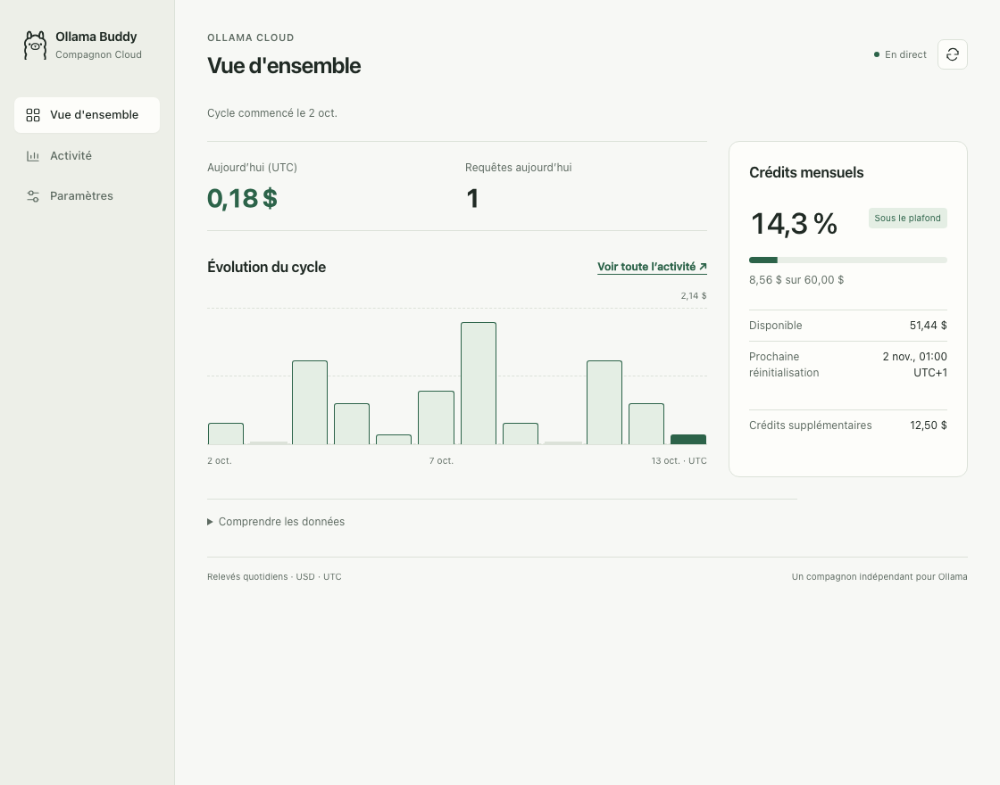
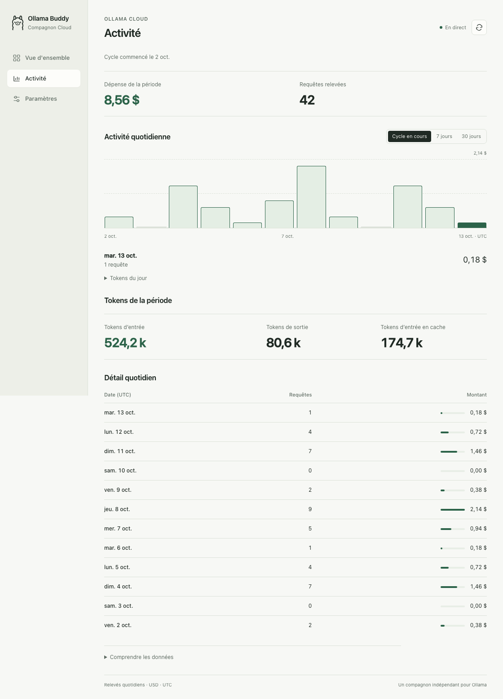
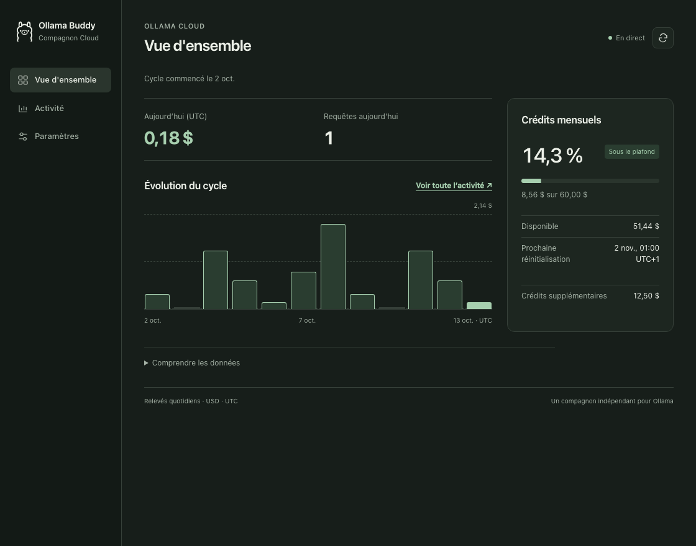
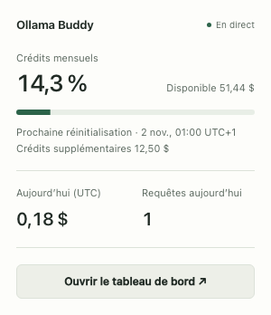

<div align="center">
  
  <h1>Ollama Buddy</h1>
  <p>Tes crédits et ta consommation Ollama Cloud, en un coup d’œil sur ton Mac.</p>
</div>

[English](README.md) · [Captures](#captures) · [Installation](#installation) · [Utilisation](#utilisation) · [Développement](#développement)

Ollama Buddy est un utilitaire macOS de barre de menus pour suivre ta consommation
Ollama Cloud. Consulte tes crédits restants sans ouvrir le site, puis explore les
dépenses quotidiennes, requêtes et tokens dans le tableau de bord. L’app lit les API
officielles Ollama avec ta propre clé.



## Fonctionnalités

- **Crédits officiels** : plafond réel, solde restant et date de renouvellement.
  Les crédits supplémentaires restent séparés ; les anciennes offres par session/semaine sont prises en charge.
- **Activité quotidienne** : explore le cycle de facturation ou ses 7/30 derniers jours.
  Dépenses, requêtes, tokens et tableau suivent la même sélection.
- **Résumé dans la barre de menus** : pourcentage consommé, crédits disponibles et usage
  du jour ; orange à 70 %, rouge à 90 %.
- **Alertes facultatives** : notifications natives à 70 %, 90 % et 100 %, sans répétition des seuils.
- **Projection estimative** : disponible après au moins 24 heures de mesures comparables.
- **Préférences partagées** : français/anglais et thèmes système/clair/sombre dans les deux vues.
- **Stockage local** : clé dans le Trousseau macOS, relevés dans SQLite. Aucun framework
  frontend ni dépendance Python tierce à l’exécution.

## Captures

Ces captures montrent l’interface utilisée par l’app, avec des données fictives.
L’aperçu principal est affiché ci-dessus ; les autres vues sont disponibles ci-dessous.

<details>
<summary>Activité, paramètres, thème sombre et barre de menus</summary>

### Activité

Sélectionne un jour pour consulter sa dépense et ses requêtes. Les tokens et relevés suivent la période choisie.



### Paramètres

Gère la connexion, le calcul de secours facultatif, les alertes et l’apparence.


### Thème sombre



### Panneau de la barre de menus



</details>

## Installation

**Prérequis** : macOS 12 ou ultérieur, Apple Silicon ou Intel, outils de ligne de
commande Xcode et Python 3.9+. Pillow sert uniquement à générer l’icône pendant la
construction. Le lanceur natif utilise `/usr/bin/python3`, fourni par les outils Xcode.

Installe les outils Xcode si nécessaire, puis construis l’app localement :

```bash
xcode-select --install

git clone https://github.com/fwBoa/ollama-buddy.git
cd ollama-buddy
python3 -m venv .venv
source .venv/bin/activate
python3 -m pip install pillow
./build_app.sh
open "Ollama Buddy.app"
```

La construction produit une app universelle contenant les deux architectures.
Glisse-la dans Applications, ou construis et copie-la avec `./build_app.sh --install`.

> [!IMPORTANT]
> Le bundle porte une signature ad-hoc, sans notarisation Developer ID.
> Gatekeeper peut bloquer un bundle téléchargé ; la construction locale est recommandée.

Le tableau de bord fonctionne aussi sans l’enveloppe macOS :

```bash
python3 ollama_buddy.py
# Options : --no-browser --port 11499
```

Ce mode nécessite uniquement Python 3.9+ et sa bibliothèque standard. Les notifications
natives et le stockage dans le Trousseau nécessitent l’app macOS.

## Utilisation

1. Crée une clé sur [ollama.com/settings/keys](https://ollama.com/settings/keys).
2. Colle-la dans le tableau de bord et sélectionne **Connecter le compte**.
3. Le plafond et le cycle sont lus automatiquement via
   [Balance Ollama](https://docs.ollama.com/api/balance).
4. Utilise **Vue d’ensemble** pour le jour et les crédits mensuels, **Activité** pour
   l’analyse d’une période et **Paramètres** pour la connexion, les alertes et l’apparence.

Les renouvellements sont affichés en heure locale, avec la référence UTC exacte en
infobulle. Les relevés quotidiens restent en UTC. Le bouton d’actualisation redemande
les données ; le cache partagé limite normalement les lectures à une par minute et
par endpoint. Une limitation respecte `Retry-After`. Ollama peut publier l’usage avec un délai.

Fermer la fenêtre laisse l’app dans la barre de menus. Quitter arrête le serveur lancé
par cette instance ; un serveur natif compatible réutilisé reste actif.

| Raccourci | Action |
|---|---|
| `⌘1` | Afficher la fenêtre |
| `⌘R` | Recharger le tableau de bord |
| `⌘⇧R` | Redemander les données Cloud |
| `⌘O` | Ouvrir dans le navigateur |
| `⌘Q` | Quitter |

### Crédits, cycles et tokens

- **Crédits mensuels consommés** = plafond inclus − solde inclus restant.
  La dépense quotidienne peut aussi utiliser des crédits supplémentaires : les deux montants peuvent différer.
- **Requêtes** désigne les appels API des relevés disponibles, pas des conversations
  ou des jours. Les relevés et compteurs manquants restent indisponibles au lieu de devenir zéro.
- Les **tokens d’entrée en cache** sont déjà inclus dans les tokens d’entrée ; ils ne sont pas ajoutés une seconde fois.
- L’activité commence au dernier renouvellement. Un reset en cours de journée UTC
  ne permet pas de découper le premier relevé, qui peut inclure de l’usage antérieur.
  Le solde officiel suit toujours l’heure exacte du renouvellement.
- Si Balance est indisponible, **Estimation de secours** utilise une référence UTC
  saisie et les relevés complets. Le premier jour partiel est exclu ; un historique
  incomplet empêche l’estimation du quota. Les plafonds de secours intégrés sont
  Pro 60 $, Max 300 $, Team 1 000 $ ; une saisie manuelle les remplace. Ce sont des
  valeurs de l’app, pas des tarifs de référence. Le compte local n’est interrogé
  que lorsque ce secours en a besoin.
- Les anciennes offres affichent les pourcentages restants Session/Semaine, sans
  dollars mensuels ni alertes mensuelles inventés. Dépenses et tokens peuvent être indisponibles.
- Pour les équipes, le solde est partagé ; l’activité lue par cette app reste personnelle.
  L’API ne fournit pas encore la [répartition par modèle](https://docs.ollama.com/api/cloud-usage#coming-soon).

Les relevés sont conservés pendant 400 jours. Des journées complètes déjà enregistrées
peuvent compléter les données plus anciennes, y compris sur un cycle de 31 jours.
Remplacer ou déconnecter une clé efface l’historique local du compte ; cela ne révoque
pas la clé sur Ollama.

### Notifications et projections

Les alertes sont désactivées par défaut. Active-les dans Paramètres et autorise-les
sur macOS. Garde l’app ouverte : une notification signale le plus haut nouveau seuil
atteint dans le cycle. Redémarrer ou basculer l’option ne répète pas un seuil déjà
notifié. Une nouvelle clé, un nouveau cycle ou réglage de calcul crée un nouveau contexte.

**Projection estimative** nécessite 24 heures de mesures avec le même cycle et plafond.
Elle reste une estimation et ne prédit pas la consommation des crédits supplémentaires.

## Données et sécurité

Les données natives vivent dans `~/Library/Application Support/OllamaBuddy/`. Le mode
CLI utilise le dossier du projet, ou le dossier défini par `OLLAMA_BUDDY_DATA`.

- La clé native reste dans le Trousseau ; le mode CLI utilise un fichier privé `0600`.
  La migration native retire l’ancienne clé en clair uniquement après un transfert réussi.
- Les identifiants partent uniquement vers Ollama en HTTPS. La clé et les informations
  du compte local ne sont pas renvoyées au navigateur ; les redirections authentifiées sont refusées.
- HTTP écoute uniquement sur `127.0.0.1`. Les contrôles Host/Origin, la validation JSON,
  l’échappement du texte et une politique de scripts avec nonce protègent les interactions web.
- L’app n’est pas sandboxée. Les programmes exécutés sous ton utilisateur peuvent accéder à l’API locale.

## Dépannage

| Symptôme | Vérification |
|---|---|
| Les crédits changent, mais pas l’activité | Actualise ; les relevés peuvent être retardés ou indisponibles. Un solde valide reste visible. |
| Pas d’estimation du quota | Vérifie la référence, le plafond et l’historique de secours ; Balance ne nécessite aucun réglage manuel. |
| Trousseau indisponible après reconstruction | Déverrouille-le et autorise l’app reconstruite si macOS le demande. Réessaie la connexion dans l’app. |
| Aucune notification | Garde l’app ouverte, active les alertes et autorise les notifications dans les réglages macOS. |
| Outil de compilation ou Python absent | Installe les outils Xcode et vérifie l’environnement Python actif. |

## Développement

Python fournit les API, SQLite et le flux SSE ; Swift gère la fenêtre native, la barre
de menus, le Trousseau et les notifications. Les vues utilisent HTML/CSS/JavaScript.

| Chemin | Rôle |
|---|---|
| `ollama_buddy.py` | API Cloud, validation, cycles, cache, SQLite, HTTP et SSE |
| `web/index.html`, `web/mini.html` | Tableau de bord et panneau compact |
| `app/main.swift`, `app/Info.plist` | App native et compatibilité macOS |
| `build_app.sh`, `app/make_icon.py` | Construction universelle et génération d’icône |
| `config.example.json` | Référence de configuration |
| `tests/` | Vérifications serveur/navigateur et captures sur données fictives |

Les tests serveur utilisent un stockage temporaire, sans compte Ollama réel :

```bash
python3 -m unittest discover -s tests -p 'test_*.py' -v
```

Pour les parcours navigateur et les captures, installe les outils de développement facultatifs :

```bash
npm install --no-save --package-lock=false playwright
npx playwright install chromium
node tests/test_frontend.cjs
node tests/capture_ui.cjs
```

Le script remplace les dix PNG publics français/anglais de `docs/readme/`. Il simule
Ollama et le Trousseau, sans lire de véritables identifiants. `specs.md`, les captures
de travail dans `docs/`, les secrets, bases et artefacts restent ignorés. Reconstruis
l’app après une modification de ses sources ; les contrôles natifs se lancent avec :

```bash
"Ollama Buddy.app/Contents/MacOS/OllamaBuddy" --test-alerts
```

Utilitaire indépendant, sans affiliation officielle à Ollama.
