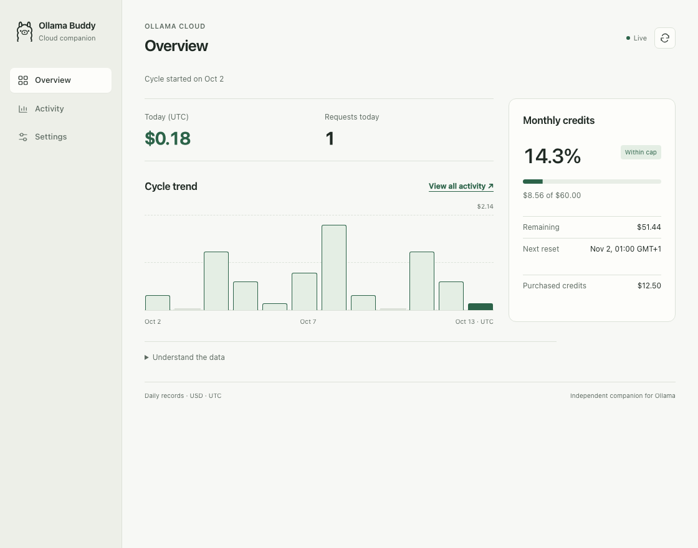
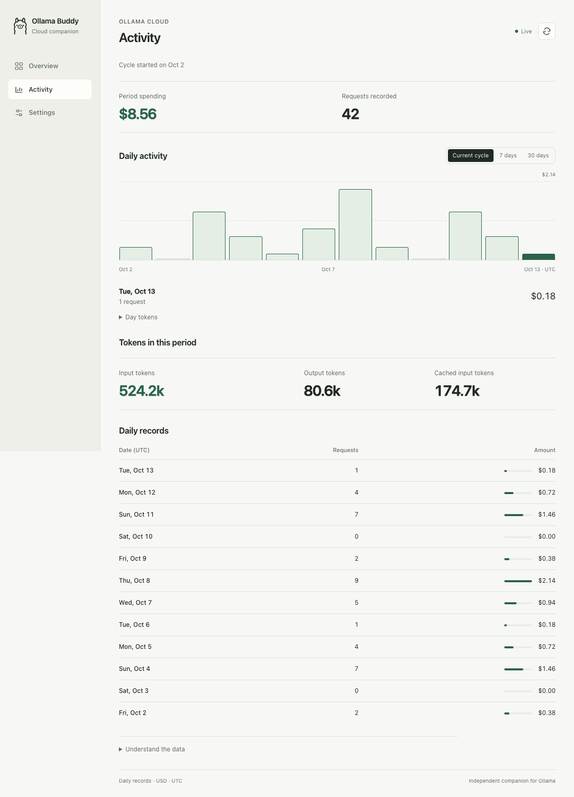
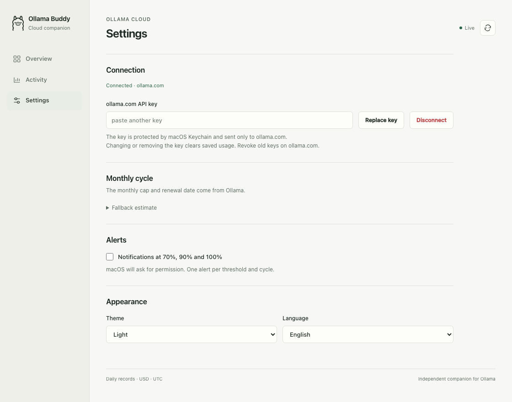
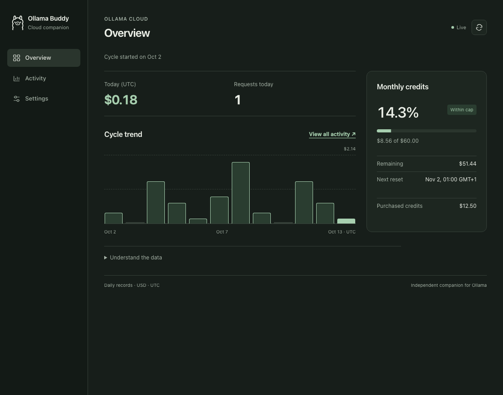
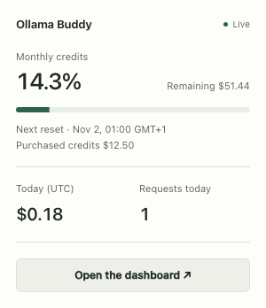

<div align="center">
  
  <h1>Ollama Buddy</h1>
  <p>Your Ollama Cloud credits and daily usage, at a glance on your Mac.</p>
</div>

[Français](README.fr.md) · [Screenshots](#screenshots) · [Install](#install) · [Usage](#usage) · [Development](#development)

Ollama Buddy is a macOS menu bar utility for following your Ollama Cloud consumption.
See your remaining credits without opening the website, then explore daily spending,
requests and tokens in the dashboard. It reads Ollama’s official APIs with your own key.



## Features

- **Official credits:** your actual monthly allowance, remaining balance and renewal date.
  Purchased credits stay separate; session/weekly limits are supported for legacy plans.
- **Daily activity:** explore the current billing cycle or its latest 7/30 days.
  Spending, request counts, tokens and the table follow the same selection.
- **Menu bar summary:** consumed percentage, remaining credits and today’s usage;
  orange at 70%, red at 90%.
- **Optional alerts:** native notifications at 70%, 90% and 100%, with threshold deduplication.
- **Estimated outlook:** projections after at least 24 hours of comparable samples.
- **Shared preferences:** English/French and system/light/dark themes across both views.
- **Local storage:** API key in macOS Keychain, readings in SQLite. No frontend framework
  or third-party Python runtime dependencies.

## Screenshots

These screenshots show the interface used by the app, with synthetic data rather than
private account information. The main preview is above; other views are below.

<details>
<summary>Activity, settings, dark theme and menu bar</summary>

### Activity

Select a day to inspect its spending and requests. Tokens and records follow the chosen period.



### Settings

Manage connection, optional fallback calculation, alerts and appearance.



### Dark theme



### Menu bar panel



</details>

## Install

**Requirements:** macOS 12 or later, Apple Silicon or Intel, Xcode command line tools
and Python 3.9+. Pillow is needed only to generate the icon during the build.
The native launcher uses `/usr/bin/python3`, provided by the Xcode tools.

Install the Xcode tools if needed, then build locally:

```bash
xcode-select --install

git clone https://github.com/fwBoa/ollama-buddy.git
cd ollama-buddy
python3 -m venv .venv
source .venv/bin/activate
python3 -m pip install pillow
./build_app.sh
open "Ollama Buddy.app"
```

The build produces a universal app containing both architectures. Drag it into
Applications, or build and copy it there with `./build_app.sh --install`.

> [!IMPORTANT]
> The bundle uses an ad-hoc signature and is not notarised with Developer ID.
> A downloaded bundle may be blocked by Gatekeeper; local builds are recommended.

The dashboard also works without the macOS wrapper:

```bash
python3 ollama_buddy.py
# Options: --no-browser --port 11499
```

This mode needs only Python 3.9+ and its standard library. Native notifications and
Keychain storage require the macOS app.

## Usage

1. Create a key at [ollama.com/settings/keys](https://ollama.com/settings/keys).
2. Paste it into the dashboard and select **Connect account**.
3. The allowance and billing cycle are read automatically from
   [Ollama Balance](https://docs.ollama.com/api/balance).
4. Use **Overview** for today and monthly credits, **Activity** for period analysis,
   and **Settings** for connection, alerts and appearance.

Reset dates use local time, with the exact UTC reference in a tooltip. Daily records
use UTC. The refresh button requests fresh data; the shared cache normally limits
reads to once a minute per endpoint, and `Retry-After` is respected after a rate limit.
Ollama may publish new usage with a delay.

Closing the window leaves the menu bar app running. Quitting stops a server started
by that app instance; a reused compatible native server is left running.

| Shortcut | Action |
|---|---|
| `⌘1` | Show the window |
| `⌘R` | Reload the dashboard |
| `⌘⇧R` | Request fresh cloud data |
| `⌘O` | Open in the browser |
| `⌘Q` | Quit |

### Credits, cycles and tokens

- **Monthly credits consumed** = included allowance − remaining included balance.
  Daily spending may also use purchased credits, so the two amounts can differ.
- **Requests** count API calls in available daily records, not conversations or days.
  Missing readings and token counters stay unavailable instead of becoming zero.
- **Cached input tokens** are already included in input tokens and are not added again.
- Activity starts at the latest renewal. A renewal during a UTC day cannot split
  that first daily record; it may include pre-renewal usage. The official balance
  still follows the exact renewal time.
- If Balance is unavailable, **Fallback estimate** uses a manually configured UTC
  reference and complete daily records. A partial first day is excluded; incomplete
  history prevents a quota estimate. Default fallback caps are Pro $60, Max $300,
  Team $1,000; a manual cap overrides them. These are app defaults, not authoritative
  prices, and the local account is queried only when needed for this fallback.
- Legacy plans show session/weekly remaining percentages without invented monthly
  dollars or monthly alerts. Daily costs and tokens can be unavailable.
- For teams, the credit balance is shared; this app reads personal activity.
  The API does not yet expose the [per-model breakdown](https://docs.ollama.com/api/cloud-usage#coming-soon).

Daily records are kept for 400 days. Saved complete days can fill older API gaps,
including 31-day cycles. Replacing or disconnecting a key clears that account’s local
history; it does not revoke the key on Ollama.

### Notifications and projections

Alerts are off by default. Enable them in Settings and grant macOS permission.
Keep the app running: one notification is sent for the highest newly reached threshold
in a cycle. Restarting or toggling alerts does not repeat an already delivered threshold.
A new key, cycle or calculation setting starts a new context.

**Estimated outlook** needs 24 hours of samples from the same cycle and allowance.
It is a projection, not a guarantee, and does not predict purchased-credit spending.

## Data and security

Native data lives in `~/Library/Application Support/OllamaBuddy/`. CLI mode uses the
project directory, or the directory set with `OLLAMA_BUDDY_DATA`.

- The native key is stored in Keychain; CLI mode uses a private `0600` configuration file.
  Native migration removes the old plaintext key only after successful transfer.
- Credentials go only to Ollama over HTTPS. Neither the key nor local account details
  are sent to the browser; authenticated redirects are refused.
- HTTP binds to `127.0.0.1` only. Host/origin checks, validated JSON, escaped dynamic
  text and a nonce-based content security policy protect browser interactions.
- The app is not sandboxed. Programs running as your user can access the local HTTP API.

## Troubleshooting

| Symptom | Check |
|---|---|
| Credits update but activity does not | Refresh; daily usage may be delayed or temporarily unavailable. A valid balance remains visible. |
| No quota estimate | Check the fallback reference, cap and history coverage; official Balance needs no manual setup. |
| Keychain unavailable after rebuilding | Unlock Keychain and authorize the rebuilt app if macOS asks. Retry connection in the app. |
| No notification | Keep the app running, enable alerts and allow notifications in macOS settings. |
| Missing build tool or Python | Install the Xcode command line tools and check the active Python environment. |

## Development

Python serves the API, SQLite storage and SSE stream; Swift provides the native window,
menu bar, Keychain and notifications. The web views are plain HTML/CSS/JavaScript.

| Path | Purpose |
|---|---|
| `ollama_buddy.py` | Cloud reads, validation, cycles, cache, SQLite, HTTP and SSE |
| `web/index.html`, `web/mini.html` | Dashboard and compact panel |
| `app/main.swift`, `app/Info.plist` | Native app and macOS compatibility |
| `build_app.sh`, `app/make_icon.py` | Universal build and icon generation |
| `config.example.json` | Configuration reference |
| `tests/` | Backend/browser checks and synthetic screenshot generation |

Backend tests use temporary storage and require no real Ollama account:

```bash
python3 -m unittest discover -s tests -p 'test_*.py' -v
```

For browser checks and screenshot generation, install the optional development tools:

```bash
npm install --no-save --package-lock=false playwright
npx playwright install chromium
node tests/test_frontend.cjs
node tests/capture_ui.cjs
```

The screenshot script replaces the ten public English/French PNGs in `docs/readme/`.
It uses mocked Ollama responses and Keychain; it never reads real credentials.
`specs.md`, working screenshots in `docs/`, secrets, databases and build artefacts
remain ignored. Rebuild after application source changes; native checks run with:

```bash
"Ollama Buddy.app/Contents/MacOS/OllamaBuddy" --test-alerts
```

An independent utility, not an official Ollama application.
