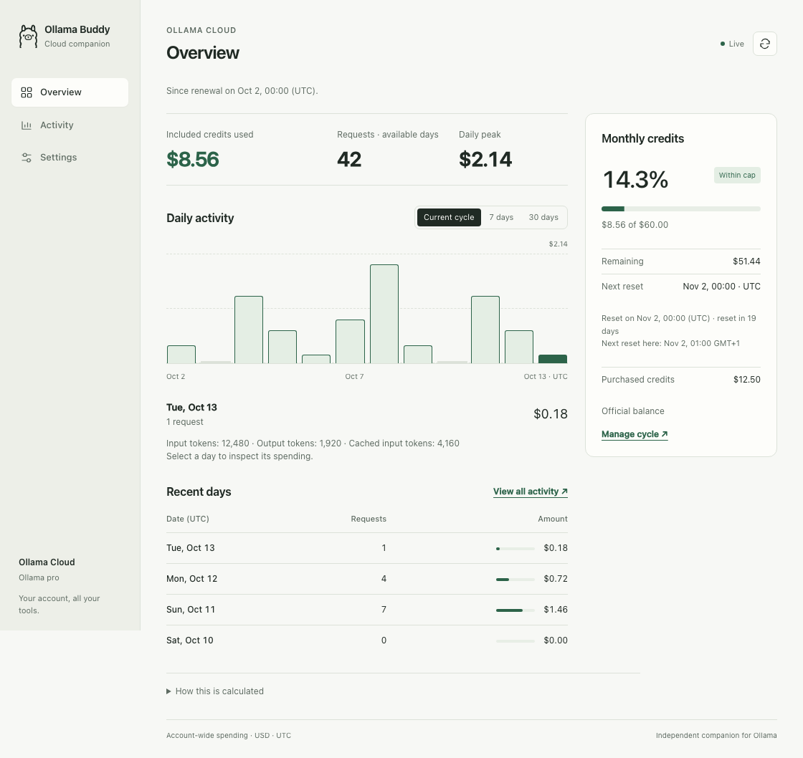
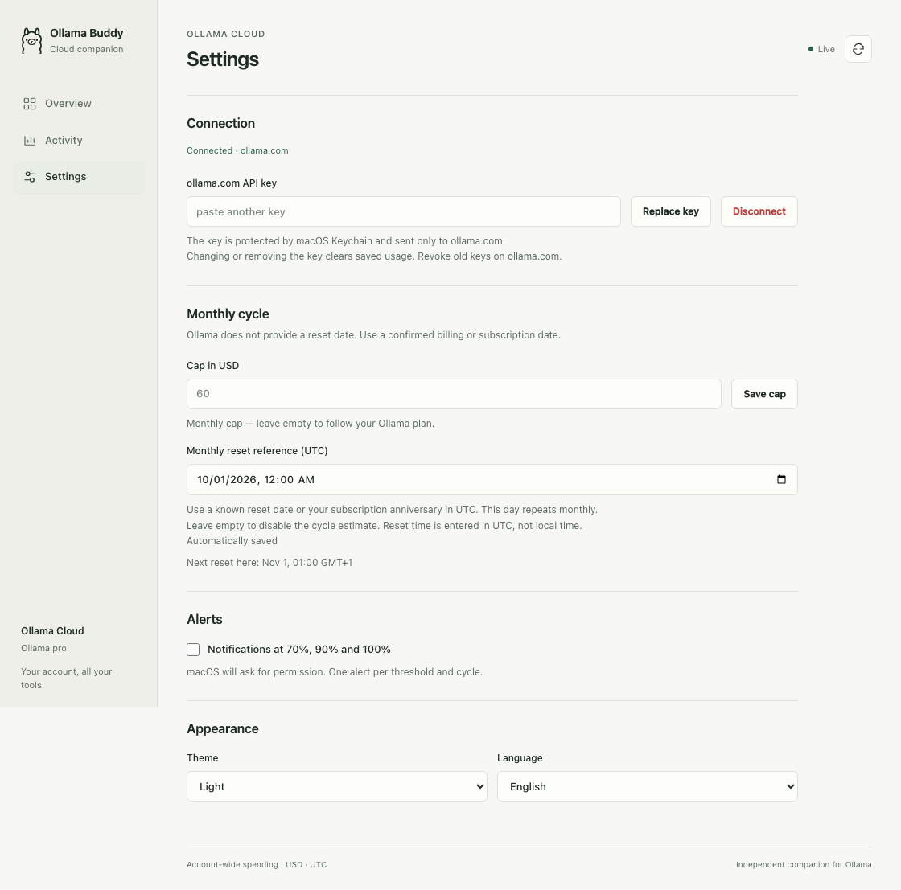
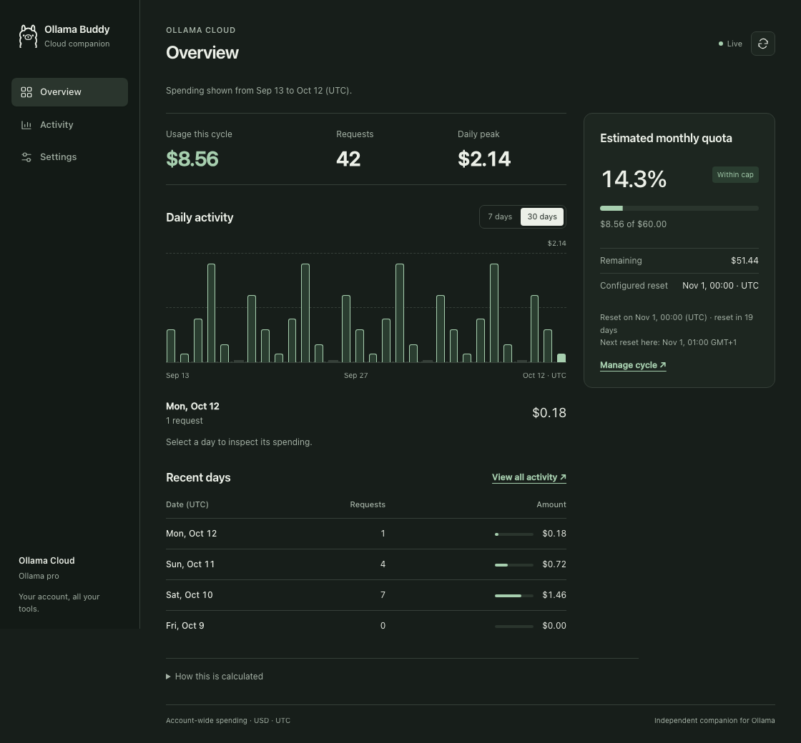
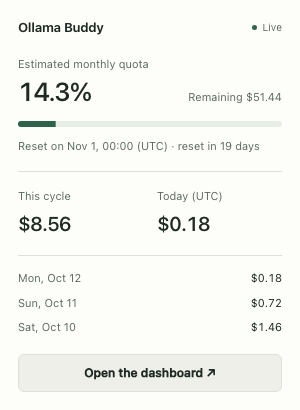

<div align="center">
  
  <h1>Ollama Buddy</h1>
  <p><em>Your Ollama Cloud spending on your Mac — cycle, quota estimate, live updates</em></p>

  [Français](README.fr.md) · [Interface](#interface) · [Install](#install) · [Monthly cycle](#monthly-cycle) · [Security](#security)
</div>

Ollama Buddy reads your account's daily cloud spending with your own API key. A
Python server serves a dashboard in a native macOS window, with a compact summary
in the menu bar. Running the server directly also works in a browser.

- Overview with spending, requests, estimated quota and the four most recent days.
- **Activity** view with an interactive 7/30 calendar-day chart and every daily
  record in the available period. Missing records are distinct from zero spending.
- Dedicated settings for connection, monthly cycle, alerts and appearance.
  Unfinished input survives live updates.
- Estimated monthly quota, reset countdown and projections once a full day of
  samples has accumulated.
- Optional native notifications at 70%, 90% and 100% of the estimated quota.
- English/French and automatic/light/dark themes in Settings, shared between both views.
- Native API-key storage in macOS Keychain, with migration from the previous file.
- Python 3.9+ standard library at runtime; no frontend framework or build step.

## Interface

Redesign screenshots use synthetic data and the same server and pages as the app.

**Overview**: cycle spending, requests, estimated quota and recent days.
Select a chart bar to inspect a day's record.



<details>
<summary>Explore activity, settings, dark mode and the menu bar</summary>

### Activity

Switch between 7 and 30 calendar days and inspect every record in the available
period. Missing records are distinct from days with zero spending.


### Settings

Configure the connection, monthly cycle, alerts and appearance. The reset
reference is entered in UTC; its local equivalent is shown to prevent timezone
confusion.



### Dark mode



### Menu bar

Check the estimated quota, cycle spending and recent days, then open the full
dashboard from the panel.



</details>

## Install

To build the native app: macOS 12+, Xcode command line tools (`swiftc`, `lipo`,
`iconutil`, `codesign`), Python 3.9+ and Pillow for the icon.

```bash
xcode-select --install
pip3 install pillow

git clone https://github.com/fwBoa/ollama-buddy.git
cd ollama-buddy
./build_app.sh
open "Ollama Buddy.app"
```

The bundle contains both Apple Silicon and Intel executables. Add `--install` to
copy it into `/Applications`. The native launcher uses `/usr/bin/python3`, so its
runtime requires the Xcode command line tools too.

The app is signed ad-hoc, without Developer ID notarisation. A downloaded bundle
can be blocked by Gatekeeper; building locally is the recommended installation.
Only for a bundle you trust, removing its quarantine marker is possible with:

```bash
xattr -dr com.apple.quarantine "/Applications/Ollama Buddy.app"
```

To use the dashboard without the native wrapper:

```bash
python3 ollama_buddy.py
# Optional: --no-browser --port 11499
```

Closing the native window keeps the menu bar app running. `⌘Q` stops the server
if this app started it; a compatible pre-existing native server stays running. A plain CLI server is
kept separate so the native app can use Keychain storage.

## Connect and configure

1. Create an API key at [ollama.com/settings/keys](https://ollama.com/settings/keys).
2. Paste it into the dashboard.
3. In **Settings**, enter **Monthly reset reference (UTC)**, including the time if known. Use
   a reset date displayed by Ollama, or the subscription anniversary converted to UTC.
   This reference can be in the past; the app replays its day of the month.
4. Check **Cap in USD**. An explicit value overrides the local Ollama plan.
   Leaving it empty uses the built-in plan defaults: Pro $60, Max $300, Team $1,000.
   Unknown plans have no inferred cap. Confirm your own plan, especially legacy plans.

The cap values and subscription-day rule follow [Ollama's pricing FAQ](https://www.ollama.com/pricing),
checked on 12 October 2026. They can change; the manual cap remains available.

The top-right button refreshes cloud data. Theme and language selectors live
in Settings and default to the system preferences. Both are saved on the server.

Reset dates include the configured UTC time and its local equivalent. For
example, noon UTC is 2 pm in Paris in October. The estimate waits for that
configured time: an actual refill on Ollama may therefore precede the local
estimate when the reference is wrong. Ollama’s displayed refill date is the
authority; this API does not expose the website’s credit balance. Disconnecting
requires confirmation and clears the account’s locally saved usage.

| Shortcut | Action |
|---|---|
| `⌘1` | Show the window |
| `⌘R` | Reload the dashboard |
| `⌘⇧R` | Invalidate the cache and refresh |
| `⌘O` | Open in the browser |
| `⌘Q` | Quit |

The menu bar shows a llama and the estimated percentage, with an orange alert
at 70% and red at 90%. Unavailable usage shows a dash. Its summary shows the
last three days. Old model counters are no longer shown.

## Monthly cycle

Ollama says included credits reset monthly on the subscription's original day of
the month, including annual subscriptions. Switching to the new pricing resets
usage immediately while keeping that original anniversary.

The app does **not** discover your subscription date or observe credit resets.
Its configured UTC timestamp is the monthly anchor. Both cycle boundaries are
calculated from that original anchor, so a day 31 becomes February 28/29 and
returns to day 31 in March. Old anchors are replayed without a one-year limit.
Clearing the date removes the cycle calculation. For subscriptions on day 29,
30 or 31, use the original subscription date: a reset clipped to February
28 does not reveal the original day.

The API integration requests `https://ollama.com/api/usage?range=30d` and expects
`buckets` with `from`, `usage_usd`, `request_count`, plus `totals`. This usage route
is undocumented and its response format can change. The source was adapted to
this format on 7 October 2026; it no longer reads `limits.monthly.usage`.

**The quota is an estimate, not Ollama's authoritative remaining credit balance.**
The app sums the available daily spending in the configured cycle and divides
by the cap. Buckets are UTC days: if the cycle starts during a day, that entire
partial first day is excluded because the API cannot split it at the reset time.
Changing the reset hour can therefore change the sum. Refunds, purchased credits,
plan switches and differing billing attribution are not reconstructed.

Each successful read updates daily spending in SQLite, retained for 400 days.
This lets an app that has already observed the days complete a 31-day cycle even
when the next API response covers only 30 days. Old buckets replace their earlier
reading (including corrections); a partial leading bucket never overwrites a
complete stored day. Switching keys clears this history to keep accounts separate.

A fresh installation cannot recover days that the API no longer supplies. A gap
in the cycle history withholds the quota rather than producing a truncated sum.
Daily spending stays visible without a cap, reset date or complete cycle: the
view then shows the available last 30 days and their date range. The cycle view
is used when its daily history is complete, even if only its cap is missing.
A missing key or an invalid/failed API read hides the spending and explains why.

Samples are recorded at most every five minutes. The average daily rate requires
at least 24 hours of samples from the current cycle. Projections extrapolate that
rate and can differ from future spending. They live in a collapsed **Estimated
outlook** section. Changing the cap or cycle clears rate samples, while keeping
the daily history, so incompatible measurements are never mixed.

The old per-model counters are archived data and are no longer displayed. The
current app focuses on daily spending. Replacing a key **does not revoke it on
Ollama**; revoke it on Ollama's settings page.

## Notifications

Enable **Notifications at 70%, 90% and 100%** in Settings in the native app.
The feature is off by default. macOS asks for notification permission, and the
page explains when system settings block notifications. No alert is generated
without a calculated quota. Keep the native app running for alerts to work.

The highest threshold reached is notified once per cycle. If usage jumps from
below 70% to 95%, one 90% alert is sent. Falling below and recrossing a notified
threshold, restarting the app or toggling alerts does not repeat it. A new cycle,
key, cap or reset anchor starts a new alert context. Clicking the alert opens the
dashboard. These alerts use the estimated quota, not an official credit balance.
Notifications are unavailable for a standalone CLI server.

## Security

- The server binds only to `127.0.0.1`, on port `11499` by default.
- Requests must use the actual local host and port. Foreign browser origins and
  cross-site requests are rejected, protecting against cross-site settings changes
  and DNS rebinding. Refresh is a POST action.
- Settings endpoints require a JSON object, bounded request size, known fields,
  finite non-negative amounts, a valid timestamp and supported preference values.
- The native app stores the key in **macOS Keychain**, through its signed native
  executable and Security framework. The key is passed through standard input,
  never command-line arguments. No third-party key-storage dependency is used.
- On native launch, an existing plaintext key is copied to Keychain before it is
  removed from `config.json`. If access fails, the file is kept and migration is
  retried rather than losing the key. macOS may ask you to authorize access again
  after rebuilding the ad-hoc signed app.
- Standalone CLI launches keep the private-file storage (`0600`) unless launched
  with `OLLAMA_BUDDY_KEYCHAIN_HELPER` pointing to the new native executable.
  CLI file storage remains plaintext. Keychain protects storage at rest; it does
  not make this app an isolation boundary against software running as your user.
- The key goes to `ollama.com` in the HTTPS Authorization header. It is never sent
  back to the dashboard. The account payload exposes only the plan, not the email.
- Dynamic error text is HTML-escaped. Pages carry a nonce-based script policy,
  deny framing and restrict their network requests to the local server.

These protections target browser-origin attacks. Local programs can still access
the HTTP API. The native bundle is not sandboxed or notarised.

## Development and data

| File | Role |
|---|---|
| `ollama_buddy.py` | Cloud/account reads, cycle calculation, SQLite, HTTP and SSE |
| `web/index.html` | Dashboard, settings and translations |
| `web/mini.html` | Menu bar summary |
| `app/main.swift` | Native lifecycle, windows, menus and navigation |
| `app/make_icon.py` | Pillow/iconutil icon generator |
| `build_app.sh` | Universal bundle assembly |
| `config.example.json` | Configuration shape; zero cap follows the plan |
| `tests/test_backend.py` | Cycle, validation, cache, storage and HTTP regression tests |
| `tests/test_frontend.cjs` | Browser regression tests with synthetic data; requires Playwright |
| `tests/capture_ui.cjs` | English/French README screenshots using synthetic data |

The native app stores `config.json` and `usage.db` in
`~/Library/Application Support/OllamaBuddy/`. Direct launches use the project
folder unless `OLLAMA_BUDDY_DATA` selects another directory. Secrets, databases
and build artefacts are ignored by Git.

SQLite stores `daily_usage` and `cloud_samples`, using WAL mode. Legacy model
rows/colours may remain in older databases but have no display. Deleting the
base loses the saved daily history and rate samples; only what is still available
from the API can be recovered. Startup also removes unused legacy tables.

The web views receive SSE pushes, with keepalives and reconnection. The dashboard
falls back to five-second polling if EventSource is unavailable. A watcher checks
every two seconds; shared caching limits cloud reads to roughly one per minute
except explicit refreshes. A minute tick updates the cycle/countdown even if
spending has not changed. The native menu bar separately reads the cached payload
every 20 seconds.

Run the backend tests without dependencies or a real Ollama account:

```bash
python3 -m unittest discover -s tests -p 'test_*.py' -v
```

The browser suite is run with `node tests/test_frontend.cjs` when Playwright and
its Chromium browser are available. It uses a temporary data directory, mocked
Ollama responses and a simulated Keychain, without touching real credentials.

Regenerate the English and French README screenshots with the same dependencies:

```bash
node tests/capture_ui.cjs
```

Screenshots also use synthetic data without accessing your account or Keychain.
The script only replaces the demonstration PNGs in `docs/`.

After building, the native threshold/deduplication checks can be run with:

```bash
"Ollama Buddy.app/Contents/MacOS/OllamaBuddy" --test-alerts
```

Real Keychain access and notification permission are completed by macOS on native
launch/opt-in. Rebuild the bundle after source edits to use the latest version.

[MIT licence](LICENSE). This is an independent app, not an official Ollama client.
